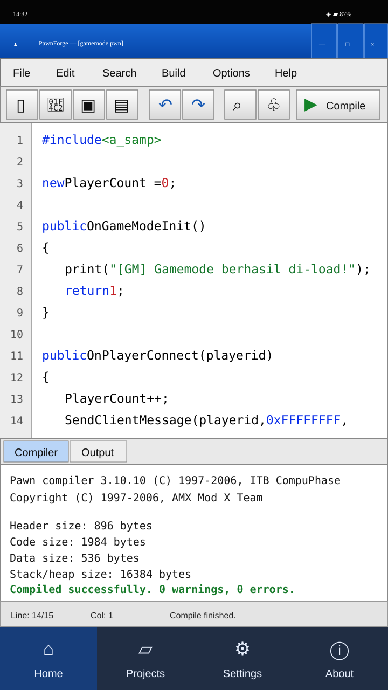
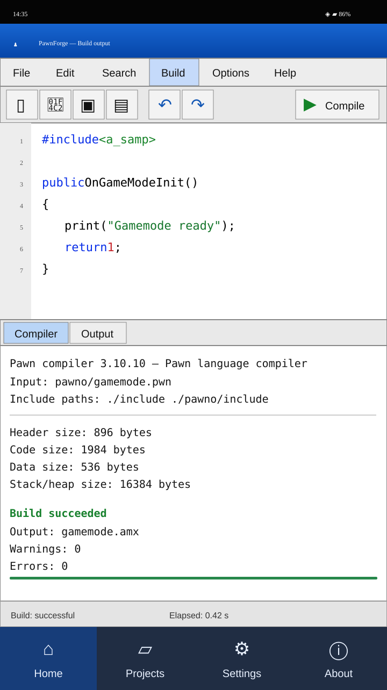
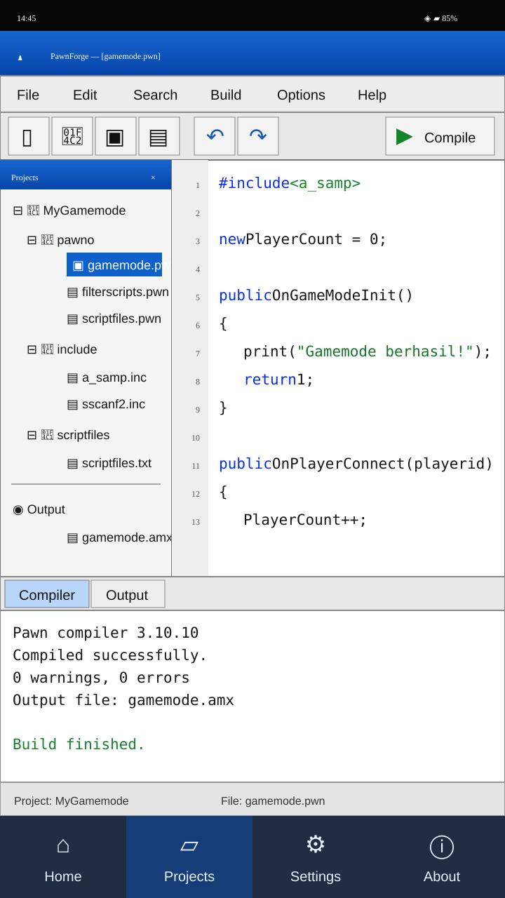

# PawnForge — Design Preview

Konsep antarmuka Android untuk compiler Pawn SA-MP / open.mp, dengan tampilan klasik yang terinspirasi Pawno dan Qawno.

> Ini adalah mockup konsep visual, bukan aplikasi yang sudah berjalan.

## 1. Home dan Editor

[Open SVG](assets/home-editor.svg)

## 2. Compiler dan Build Output

[Open SVG](assets/build-output.svg)

## 3. Project Explorer

[Open SVG](assets/projects.svg)

## Arah desain

- Title bar biru dan menu klasik seperti aplikasi Pawno/Qawno.
- Editor Pawn dengan nomor baris dan syntax highlighting.
- Panel Compiler/Output di bawah editor.
- Project explorer dengan folder `pawno`, `include`, dan `scriptfiles`.
- Navigasi Android di bagian bawah.

